<h1 align="center">Taskbar Monitor</h1>

<p align="center">
  Real-time hardware monitor anchored to the Windows 11 taskbar, the Linux desktop panel or the Mac Dock, with a pixel-art kitten for company
</p>

<p align="center">
  
  
  
  
  
  
</p>

<p align="center">
  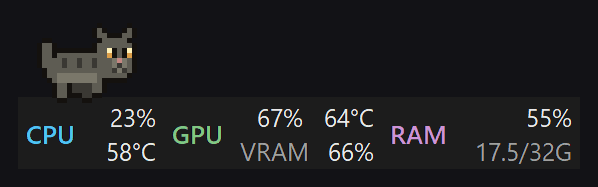
</p>

---

## Installation

Download the latest version from the [releases page](https://github.com/Miguelzvd/TaskbarMonitor/releases/latest).

### Windows

Needs **Windows 11**, the **.NET 8 Desktop Runtime** and **administrator** rights. Designed for a **horizontal bottom** taskbar.

1. Download the installer, `TaskbarMonitor-Setup-<version>.exe`, from the page above.
2. Run the installer. It installs into `C:\Program Files\TaskbarMonitor`, closes the previous version and keeps autostart working. It also installs [PawnIO](https://pawnio.eu), needed for the CPU temperature, and downloads the .NET 8 Desktop Runtime if it is missing.

Want to run without installing? The `.zip` is portable, but extract it to a fixed folder: autostart stores the exe path. In that case, install what's missing yourself: `winget install Microsoft.DotNet.DesktopRuntime.8` and [PawnIO](https://pawnio.eu).

If the CPU temperature is missing, right-click the widget and choose **Enable CPU temperature** (or, with the `.zip`, install [PawnIO](https://pawnio.eu) and restart the app).

### Linux

Download the package for your system. No administrator rights are needed to run the app.

- **Debian, Ubuntu, Mint:**
  ```sh
  curl -fLO https://github.com/Miguelzvd/TaskbarMonitor/releases/latest/download/taskbar-monitor-linux-x64.deb
  sudo apt install ./taskbar-monitor-linux-x64.deb
  ```
- **Fedora, openSUSE:**
  ```sh
  sudo dnf install https://github.com/Miguelzvd/TaskbarMonitor/releases/latest/download/taskbar-monitor-linux-x64.rpm
  ```
- **Any distribution:**
  ```sh
  curl -fLO https://github.com/Miguelzvd/TaskbarMonitor/releases/latest/download/TaskbarMonitor-x86_64.AppImage
  chmod +x TaskbarMonitor-x86_64.AppImage && ./TaskbarMonitor-x86_64.AppImage
  ```

Running the same command again updates to the newest version.

Then open **Taskbar Monitor** from your applications menu, or run `taskbar-monitor`. It sits on your desktop panel and can start at login (right-click → **Start at login**). The kitten needs a desktop with transparency effects enabled.

### macOS

Needs a Mac with **Apple Silicon** (M1 or newer). No administrator rights are needed.

1. Download `TaskbarMonitor-macos-arm64.dmg` from the [releases page](https://github.com/Miguelzvd/TaskbarMonitor/releases/latest).
2. Open it and drag **Taskbar Monitor** to **Applications**.
3. The first time, macOS says it can't check the developer. Open **System Settings → Privacy & Security**, scroll down and click **Open Anyway** next to Taskbar Monitor. After that it opens normally.

It sits right above the Dock and stays out of the Dock and of the app switcher: right-click it for every option, including **Exit**.

## Features

- **CPU**: total usage and temperature (Tctl/Tdie on AMD, Package on Intel)
- **GPU**: core usage and temperature, with the **VRAM** right below (% and used/total)
- **RAM**: % and used/total
- Follows the Windows light/dark theme and stays out of Alt+Tab
- Alert colors: usage ≥ 70% turns yellow and ≥ 90% red; temperature ≥ 72°C turns yellow and ≥ 85°C red

  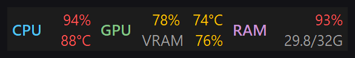

- Skeleton with shimmer until the first reading arrives

  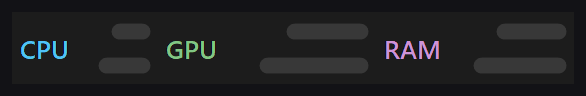

- One tooltip per block: hover CPU, GPU (with the VRAM in use/total/free) or RAM (in use, total and available)
- Top processes in each tooltip: the programs using the most CPU, GPU or memory, five at a time with the mouse wheel for more (up to 40). Hover a row and click the red button to end that program, with a confirmation first
- Fullscreen (app or game): the widget moves to the other monitor and returns when fullscreen ends; with a single monitor it hides. Windows' own windows (Start, Search, screen snipping) don't count
- Stays above the taskbar without flicker when you click it (the taskbar owns the window)

### Styles

Five looks, chosen in the right-click menu under **Style**. Every block shows the GPU with the VRAM underneath.

| Style | Dark | Light |
|---|---|---|
| **Classic** | 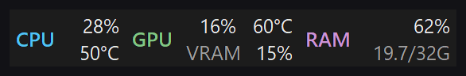 | 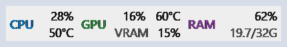 |
| **Progress bars** | 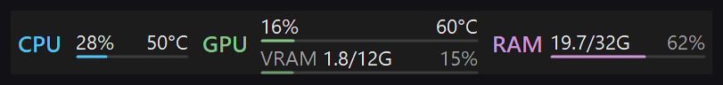 | 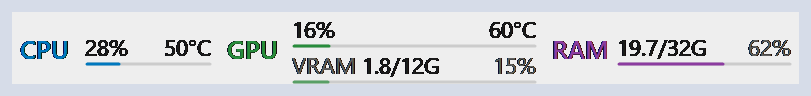 |
| **Rings** | 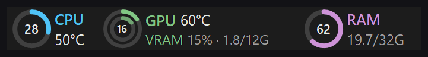 | 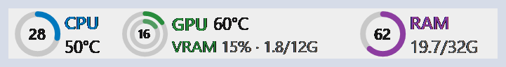 |
| **Sparklines** | 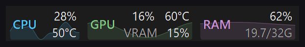 | 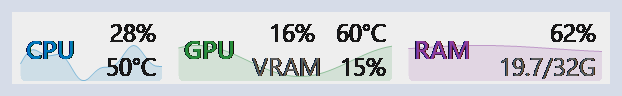 |
| **Pills with icons** | 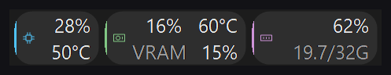 | 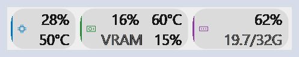 |

### Companion (kitten)

A pixel-art cat lives on top of the monitor, with a 1 px outline. The mouse goes through it. Pick it under **Companion** in the menu: off, a gray, white, black or orange cat, or your own colors. **Customize…** opens the **Companion** tab of **Settings**, with a live preview where you choose the fur, light fur, stripes, eyes, nose and outline colors, plus the bat mask: its color and whether the cat wears it only upside down, always or never. Its **Animations** page turns each of its animations on or off.

### Hide and show

Press **Ctrl+Alt+Shift+T** (on a Mac, **⌃⌥⇧T**) to hide the monitor and the kitten, and again to bring them back. You can also choose **Hide monitor** in the right-click menu. Pick other keys in **Settings → General**: click the box and press the new combination. If another app already uses it, Settings tells you and keeps the old one.

While the monitor is hidden, a small kitten waits for you: in the menu bar at the top of the screen on a Mac, next to the clock on Windows, and in the panel's tray on Linux. Click it to bring the monitor back. Its menu can also show the CPU, GPU and RAM numbers: next to the kitten on a Mac, and when you hover it on Windows and Linux.

<p align="center">
  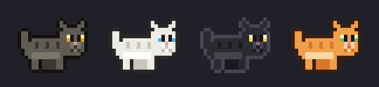
</p>

What it does depends on the PC:

- **Walks for ~6 s** from side to side of the monitor and turns at the ends, with its own frames for turning

  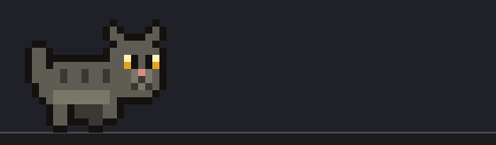

- **Lies down where it stopped and stays ~5 min**. While lying, it alternates between staying still, licking itself and kneading, always resting between actions and never repeating the same one twice. Then it gets up and walks again

  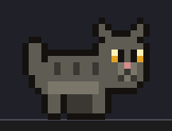

- **Sleeps** (curled up, breathing) after ~20 s with CPU and GPU below 8%; wakes at 15%

  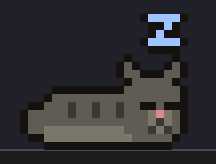

- **Swats the program you end**: end a program from a tooltip's list and it trots to that block, swats it and leaves a puff of dust. If the program can't be ended, it flattens its ears instead

- **Pants**, wide-eyed and sweating, with usage ≥ 90%, RAM ≥ 92% or temperature ≥ 85°C (back to normal below 80% / 78°C)

  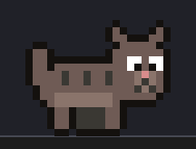

## Usage

Everything is in **Settings** (right-click → **Settings…**), in four pages:

| Page | What it has |
|---|---|
| **General** | The hide/show keys, start at login (**Start with Windows** on Windows), the update interval (0.5 / 1 / 2 / 5 s) and, on a Mac, what the menu bar shows while the monitor is hidden |
| **Monitor** | **Mode**: docked to the taskbar (above the Dock on a Mac, on the panel on Linux) at the right, center or left, or free to drag anywhere, with **Lock position** to fix it. **Style**: Classic, Progress bars, Rings, Sparklines or Pills with icons. **Text size**: Small, Normal, Large or Extra large. **Show**: CPU, GPU and RAM, and inside them the temperatures, the VRAM and the RAM amount. **Top processes**: how many programs each tooltip lists (Off, 5, 10, 20 or 40) |
| **Companion** | Off, a gray, white, black or orange cat, or your own colors and animations |
| **Menu** | Which of these options the right-click menu shows too |

The **right-click menu** shows the options you pick in **Settings → Menu**. At first it has **Mode**, **Update interval**, **Hide monitor** and **Start at login**; **Settings…** and **Exit** are always there.

Settings live in `%AppData%\TaskbarMonitor\settings.json`.

"Start with Windows" creates a Task Scheduler task with elevated privilege: no UAC prompt at logon, no stop after 3 days, and it runs on battery.

## Known limitations

- A vertical or top taskbar isn't handled.
- In docked mode it only uses the main taskbar. The secondary one only serves as a destination when the widget flees a fullscreen app.
- In docked **Center** mode with centered icons on Windows 11, the monitor covers pinned icons. If the default position overlaps an icon, switch to free mode and drag it.
- In free mode, over the taskbar, a flicker of a few milliseconds may still happen when clicking it.
- Hybrid GPUs: the dedicated one has priority (NVIDIA > AMD > Intel).
- Linux: moving away from fullscreen apps may not work on every desktop setup, and on some desktops the hide/show keys aren't available. The kitten in the tray needs a panel with a tray (on GNOME, the AppIndicator extension).
- Mac: Apple Silicon only. CPU and GPU temperatures aren't shown yet, and the process lists show your own programs, not the system's.

## License

[MIT](LICENSE)
