<h1 align="center">Taskbar Monitor</h1>

<p align="center">
  Real-time hardware monitor anchored to the Windows 11 taskbar or the Linux desktop panel, with a pixel-art kitten for company
</p>

<p align="center">
  
  
  
  
  
</p>

<p align="center">
  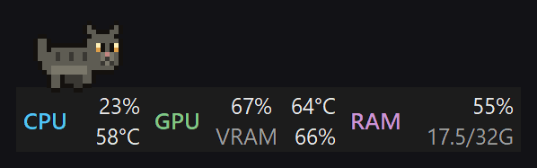
</p>

---

## Installation

Download the latest version from the [releases page](https://github.com/Miguelzvd/TaskbarMonitor/releases/latest).

### Windows

Needs **Windows 11**, the **.NET 8 Desktop Runtime** and **administrator** rights. Designed for a **horizontal bottom** taskbar.

1. Download the installer, `TaskbarMonitor-Setup-<version>.exe`, from the page above.
2. Run the installer. It installs into `C:\Program Files\TaskbarMonitor`, closes the previous version and keeps autostart working. If the .NET 8 Desktop Runtime or [PawnIO](https://pawnio.eu) (needed for the CPU temperature) is missing, it downloads and installs them for you.

Want to run without installing? The `.zip` is portable, but extract it to a fixed folder: autostart stores the exe path. In that case, install what's missing yourself: `winget install Microsoft.DotNet.DesktopRuntime.8` and [PawnIO](https://pawnio.eu).

If the CPU temperature shows `--°C`, install [PawnIO](https://pawnio.eu) and restart the app.

### Linux

Download the package for your system. No administrator rights are needed to run the app.

- **Debian, Ubuntu, Mint:**
  ```sh
  curl -fLO https://github.com/Miguelzvd/TaskbarMonitor/releases/latest/download/taskbar-monitor-linux-x64.deb
  sudo apt install ./taskbar-monitor-linux-x64.deb
  ```
- **Fedora, openSUSE:**
  ```sh
  sudo dnf install https://github.com/Miguelzvd/TaskbarMonitor/releases/latest/download/taskbar-monitor-linux-x64.rpm
  ```
- **Any distribution:**
  ```sh
  curl -fLO https://github.com/Miguelzvd/TaskbarMonitor/releases/latest/download/TaskbarMonitor-x86_64.AppImage
  chmod +x TaskbarMonitor-x86_64.AppImage && ./TaskbarMonitor-x86_64.AppImage
  ```

Running the same command again updates to the newest version.

Then open **Taskbar Monitor** from your applications menu, or run `taskbar-monitor`. It sits on your desktop panel and can start at login (right-click → **Start at login**). The kitten needs a desktop with transparency effects enabled.

## Features

- **CPU**: total usage and temperature (Tctl/Tdie on AMD, Package on Intel)
- **GPU**: core usage and temperature, with the **VRAM** right below (% and used/total)
- **RAM**: % and used/total
- Follows the Windows light/dark theme and stays out of Alt+Tab
- Alert colors: usage ≥ 70% turns yellow and ≥ 90% red; temperature ≥ 72°C turns yellow and ≥ 85°C red

  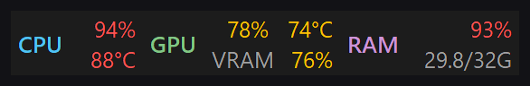

- Skeleton with shimmer until the first reading arrives

  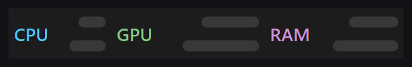

- One tooltip per block: hover CPU, GPU (with the VRAM in use/total/free) or RAM (in use, total and available)
- Fullscreen (app or game): the widget moves to the other monitor and returns when fullscreen ends; with a single monitor it hides. Windows' own windows (Start, Search, screen snipping) don't count
- Stays above the taskbar without flicker when you click it (the taskbar owns the window)

### Styles

Five looks, chosen in the right-click menu under **Style**. Every block shows the GPU with the VRAM underneath.

| Style | Dark | Light |
|---|---|---|
| **Classic** | 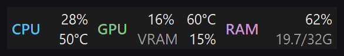 | 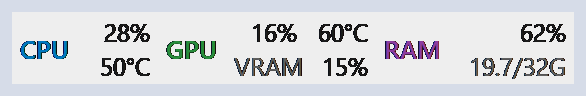 |
| **Progress bars** | 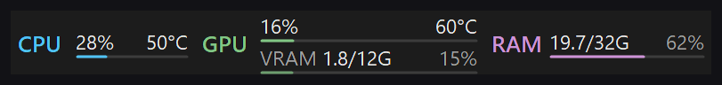 | 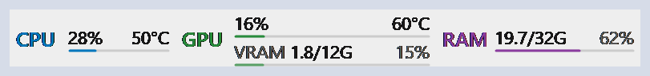 |
| **Rings** | 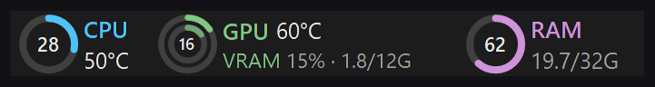 | 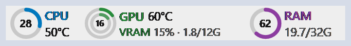 |
| **Sparklines** | 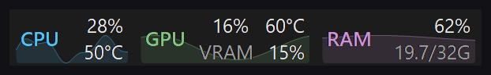 | 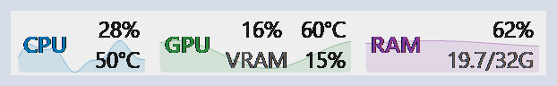 |
| **Pills with icons** | 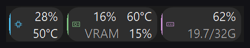 | 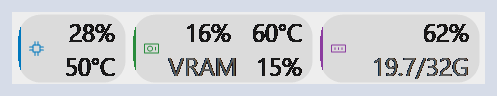 |

### Companion (kitten)

A pixel-art cat lives on top of the monitor, drawn in code with a 1 px outline. Its window is transparent and the mouse goes through it. Pick it under **Companion** in the menu: off, or a gray, white, black or orange cat.

<p align="center">
  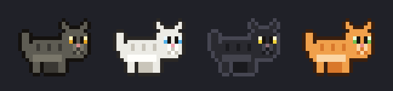
</p>

What it does depends on the PC:

- **Walks for ~6 s** from side to side of the monitor and turns at the ends, with its own frames for turning

  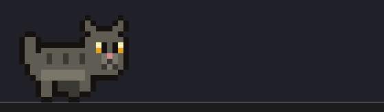

- **Lies down where it stopped and stays ~5 min**. While lying, it alternates between staying still, licking itself and kneading, always resting between actions and never repeating the same one twice. Then it gets up and walks again

  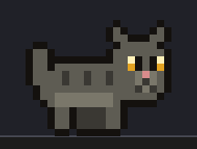

- **Sleeps** (curled up, breathing) after ~20 s with CPU and GPU below 8%; wakes at 15%

  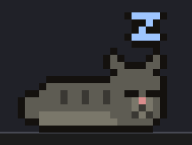

- **Pants**, wide-eyed and sweating, with usage ≥ 90%, RAM ≥ 92% or temperature ≥ 85°C (back to normal below 80% / 78°C)

  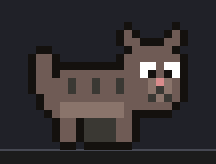

## Usage

Everything is configured from the **right-click menu**:

| Item | What it does |
|---|---|
| **Mode → Docked to the taskbar** | Stays attached to the taskbar and can't be dragged |
| **Position on the bar** *(docked mode)* | Right (next to the tray), Center or Left |
| **Mode → Free (drag)** | Drag with the left button anywhere on screen (open/closed hand cursor) |
| **Lock position** *(free mode)* | Fixes it where you dropped it. A small dot in the corner shows it's locked |
| **Style** | Classic, Progress bars, Rings, Sparklines or Pills with icons |
| **Companion** | Off, or a gray, white, black or orange cat |
| **Text size** | Small, Normal, Large or Extra large |
| **Update interval** | 0.5 / 1 / 2 / 5 s |
| **Start with Windows** | Elevated scheduled task, no UAC at logon |

Settings live in `%AppData%\TaskbarMonitor\settings.json`.

"Start with Windows" creates a Task Scheduler task with elevated privilege: no UAC prompt at logon, no stop after 3 days, and it runs on battery.

## Known limitations

- A vertical or top taskbar isn't handled.
- In docked mode it only uses the main taskbar. The secondary one only serves as a destination when the widget flees a fullscreen app.
- In docked **Center** mode with centered icons on Windows 11, the monitor covers pinned icons. If the default position overlaps an icon, switch to free mode and drag it.
- In free mode, over the taskbar, a flicker of a few milliseconds may still happen when clicking it.
- Hybrid GPUs: the dedicated one has priority (NVIDIA > AMD > Intel).
- Linux: moving away from fullscreen apps may not work on every desktop setup.

## License

[MIT](LICENSE)
